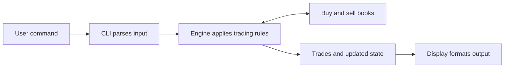

# Methodology:

In this document, I will explain my methodology to solve this problem, as well as the architectural decisions and other assumptions.


## Architecture:

The architecture is divided in 5 main components:
1. Models: contains the classes' structure and validation for all the corresponding data types (order, trade).
2. Book: stores resting limit orders and active pegged orders in price-time priority.
3. Engine: contains the logic of the system and the operations that must be done, given a book.
4. CLI: provides interface for the user, and sends the valid commands to the engine.
5. Display: provides functions returning normal/debug book, individual order, and trade text to be fed to the CLI.

Essentially, this system can be thought as a synchronous state machine, in which the state transitions are implemented through methods. The state consists of outstanding orders (type, side, quantity, price and priority) and completed trades. The state changes are triggered through order submission, amendment or cancellation.



The following sections will explain in more detail each module and its nuances.

## Models:

The Models module defines the content structure of an order and a trade, as well as validation functions for the data types.

### Order structure:
| Field | Meaning |
|---|---|
| `id` | Unique submission ID within an engine instance |
| `side` / `kind` | Buy/sell and limit/market/pegged |
| `remaining_qty` | Quantity still available to execute |
| `priority_sequence` | Latest arrival-priority position |
| `limit_price` | Fixed limit price, otherwise absent |
| `peg_reference` | Bid/offer reference for pegs, otherwise absent |
| `effective_price` | Current priced-book value; absent for markets/inactive pegs |

There are also enumerations defined in the Models, respective to the Side of an order (BUY or SELL), the OrderKind (LIMIT, MARKET, PEGGED) and the PegReference (BID, OFFER).
These enums help with readability, validation and separation.

### Trade structure:

A trade is an execution between two orders. It is useful to store past order fills in the engine's execution history.

| Field | Meaning |
|---|---|
| `buy_order_id` | ID of the buy order involved in the trade |
| `sell_order_id` | ID of the sell order involved in the trade |
| `price` | Execution price, stored as a `Decimal` |
| `quantity` | Number of units executed in the trade |

It is a frozen class because it records a completed execution, which is immutable after completion.

## Book:
The book stores the orders themselves and keeps them in price priority. It is used by the matching engine to determine the next executable order.
The book stores queues and indexes to be used by the engine.

| Structure | Contents | Purpose |
|---|---|---|
| `_prices` | Sorted list of every occupied price | Find the best price (best buy last, best sell first) |
| `_levels` | Price -> OrderedDict(ID -> Order) | FIFO at each price plus direct removal |
| `_locations` | ID -> booked price | Find the correct level without scanning |
| `_fixed_counts` | Price -> count of fixed limit orders | Track whether a price can be a peg reference |
| `_fixed_prices` | Sorted prices containing fixed orders | Find the reference for pegged orders |


The book also contains methods to `add` and `remove` orders from the book, as well as auxiliary methods to return the oldest order at the `best` price in the book for any given side. This implements price priority followed by FIFO within each price level. There is also a method to determine if the book `contains` an order of any given ID to be looked up. 
There are also methods for fetching the `fixed_reference` used by peg refreshing, and to return the `orders` and `levels` for taking snapshots in the display module.


### Optimization features:
I made some optimizations to make the code run faster, mostly related to lookups. This allows the engine to run better but has a memory drawback, with the use of extra dictionaries and arrays. This system is rather light-weight, so I assume it should not make a significant difference. However, I think it is nice to have and makes the system more scalable.


Initially, for `_levels`, each price held a list to preserve FIFO behavior. However, to cancel an order, that would need a search and subsequent shift in the array. So I implemented an `OrderedDict` keyed by ID. This protects insertion order (still FIFO), while allowing removal in average O(1) time:
```self._levels: dict[Decimal, OrderedDict[str, Order]] = {}```

However, complete cancellation can also require O(L) sorted-list shifts, peg refreshing, and resulting matches. 

For finding an order's price, the `_locations` dictionary has the order ID as the key, and the price as its value. This is useful for removal. Previously, `remove` searched the price levels and their queues until it found the ID.
Both of the aforementioned changes were necessary to avoid the search:
```
price = self._locations[order_id]
order = self._levels[price].pop(order_id)
```

Also, `best` used the functions `max(self._levels)` for buy, and `min(self._levels)` for sell. These scan all L prices, so it was O(L). Instead, by using an ascending list, `_prices`, it is enough to index the last element `_prices[-1]` for the best buy, or the first, `_prices[0]` for the best sell.

Adding separate counts and sorted prices was necessary to find fixed references. `_fixed_counts` stores the amount of  fixed limit orders remaining at each price level. It does not count, by definition, pegged orders. When the count reaches zero, the price is removed from `_fixed_counts` and `_fixed_prices`. The general price level remains until its queue is empty.

`_fixed_prices`, in turn, is a sorted list containing all available price levels (with count greater than 0, as stated above). The last element supplies the fixed bid, and the first supplies the fixed offer. 

In short, `_levels` stores the orders. The other structures are indexes maintained alongside it. Their purpose is to answer common questions quickly. Every insertion and removal must keep those indexes consistent.

## Engine:

The problem description provided a number of choices to be made in regards to the internal logic of the engine. The section below explains my decisions and assumptions. These were implemented and work as intended, as far as the tests go.

### Logic:
* When limit orders cross, the trade is executed at the resting order's price.
* If a market order consumes all available liquidity, the quantity that exceeds that is discarded (does not enter the book).
* Priority is always price first, then arrival time. Price amendment makes an order lose priority.
* Quantity reduction retains priority, quantity increase loses priority in the queue.
* Amending quantities refers to the outstanding quantity (still to be executed).
* Amending but not changing anything does not move the order.
* Amending quantity to zero is rejected. Must be done by the cancel command explicitly. 
* Pegged orders only derive their prices from fixed-price orders.
* When a pegged order arrives with no reference, it waits for a fixed-price order to appear. 
* Pegs are updated after every book changing event, before next match.
* A peg that changes price joins the back of its new price queue (lowest priority).
* Multiple pegs that move together keep their relative order.
* If a peg's updated price crosses, it is executed.
* Pegged order's quantity can be amended, following the same rules as a normal order (decrease keeps priority, increase loses).
* Pegs support buy-to-bid, sell-to-offer, buy-to-offer, sell-to-bid.

Crossing limit orders execute because their limits permit trading against the available opposite-side prices. Execution uses the resting order’s price, which satisfies the incoming order’s limit. Any unmatched quantity rests at its submitted limit price.

Peg references use only fixed limit orders to avoid self-reference. Otherwise, a peg could sustain its own obsolete price after the fixed orders supporting that reference disappear.

Quantity increases lose priority because the additional quantity should not move ahead of orders already waiting. Reductions retain priority because they add no new quantity. Price changes lose priority because the order is entering a queue at a different price.

### Order logic:
For one incoming order:
1. Find the best order on the opposite side.
2. Check whether its price is acceptable.
3. Execute the smaller remaining quantity.
4. Record the execution at the resting order’s price.
5. Reduce both quantities.
6. Remove any fully filled resting order.
7. Update peg references before choosing the next match.
8. Repeat until the incoming order finishes or cannot match.

The eligibility differs per order type:
- Market: accepts any available price.
- Limit buy: accepts sells at or below its limit.
- Limit sell: accepts buys at or above its limit.
- Peg: uses its current effective price, which could change.

After matching:
- A limit remainder rests.
- A market remainder is discarded.
- A peg remainder rests at its reference price or becomes inactive if no reference exists.

### Peg logic:
Pegged orders add a layer of complexity to the logic implemented in the engine.
* References refresh between fills. Newly executable resting pegs receive matching turns after the current incoming turn finishes.
* Incoming fixed orders become references only when their remainders rest.
* During settlement, the engine examines the best buy and sell. If the pair crosses and contains one peg, that peg takes the incoming role. If both are pegs, the order with the lowest priority takes the incoming role. The opposite resting order supplies the execution price.
* A matching turn does not guarantee a complete fill. A peg may fill partially, rest with a remainder, or become inactive if its reference disappears. Settlement repeats until no executable crossing remains.


### Design decisions and invalid values:
* On the interface, orders with same price are combined. But internally they have their own IDs and are treated separately.
* Invalid input rejects, gives error message and does nothing to the book.
* Quantity is an integer. No fractional shares.
* Price must be positive, finite Decimal.
* Price precision is exact, but interface shows fixed at 0.01 precision.
* Order IDs are unique and never reused within a single session.
* For debugging: show individual orders, remaining quantities, IDs, priority order.

### Implementation details:

The engine controls the state transitions of the system. It uses the books to store and retrieve resting orders, applies matching and priority rules, updates pegged prices, and records completed executions.
The `MatchingEngine` class maintains the following attributes:

| Attribute | Contents | Purpose |
|---|---|---|
| `_buys` | `BookSide` for buy orders | Store resting buys and retrieve the best bid |
| `_sells` | `BookSide` for sell orders | Store resting sells and retrieve the best offer |
| `_id_counter` | Increasing integer | Assign unique IDs to newly created orders |
| `_priority_counter` | Increasing integer | Assign priority sequences on creation or priority loss |
| `_trades` | List of individual `Trade` records | Preserve execution history |
| `_orders` | ID → outstanding `Order` | Find orders directly for cancellation, amendment, and inspection |
| `_pegs` | ID → outstanding pegged `Order` | Identify orders requiring reference price updates |
| `_incoming_id` | Current incoming order ID, or `None` | Prevent an incoming peg from entering the book while matching |

The books and registries reference the same order objects. Therefore, a partial fill updates one object’s `remaining_qty`, and that change is visible wherever the object is referenced.

The` _orders` registry also contains inactive pegs, which have no effective price and therefore cannot occupy a book queue. `_pegs` contains both active and inactive pegs.

The public methods `submit_limit`, `submit_market`, and `submit_peg` provide the entry points for new orders. Each calls `_create_order` with the appropriate order kind and fields, then passes the resulting order to `_submit`. Peg submissions also register the order in `_pegs`.

`_create_order` calculates the next ID and priority sequence, then constructs an `Order`. Construction runs the model’s validation. The counters are updated only after construction succeeds, so invalid creation does not consume an ID or priority sequence. This method creates the object without inserting it into a book.

`_submit` coordinates the whole submission process:
1. Save the current trade-history length.
2. Register the order in `_orders` and set `_incoming_id`.
3. Refresh pegged prices.
4. Call `_match` to execute eligible trades.
5. Record any discarded market quantity.
6. Call `_finish_incoming` to handle the remainder.
7. Clear `_incoming_id`, refresh pegs, and settle remaining crossings.
8. Return a `CommandResult` containing the executions generated during this command.

Keeping the incoming order outside the book separates the order taking a matching turn from the resting orders supplying liquidity.
#### Matching:
`_match` repeatedly calls `best()` on the opposite book. It stops when the incoming quantity reaches 0, the opposite book is empty, or the best resting price is unacceptable.

Market orders have no price boundary. Limit and pegged buys accept prices at or below their effective price; sells accept prices at or above it. A peg without an effective price cannot match.

The matching method creates a `Trade` at the resting order’s effective price, then appends it to `_trades`, and reduces both quantities. A fully filled resting order is removed from its book and registries. A fully filled incoming order is also removed from the registries. Pegs refresh after every fill, before the next resting order is selected.
#### Cancellation and amendments:
`_require_order` validates an ID and retrieves its live order from `_orders`. Unknown, completed, or cancelled IDs raise `ValueError` before mutation.
`cancel` removes the order from its book if it is priced, then calls `_forget` to remove its registry entries. It refreshes pegs and settles crossings because removing a fixed order can change references.
`_forget` removes an order from `_orders` and `_pegs`. Book removal is handled separately by the method. Completed trades remain in `_trades`.


`amend` validates every supplied field before changing the order (but it always preserves the order ID). Quantities must be positive integers, and manual price amendments are restricted to fixed limit orders. An important implementation detail is that a price change can execute immediately through the same matching process as a new submission.

For a quantity-only increase, removal and reinsertion happen before peg refreshing. This prevents the temporary removal of a fixed order from unnecessarily changing its peg reference.

#### Peg refreshing:

`_refresh_pegs` obtains the fixed bid and offer from the books’ `fixed_reference()` methods, taken before the pegs move.
It sorts outstanding pegs by their current `priority_sequence`, then updates them in two stages:
1. Remove all pegs whose effective prices have changed from their existing queues.
2. Assign their new effective prices and priority sequences, then reinsert priced pegs in their previous relative order.

An unchanged effective price preserves priority. A disappearing reference sets the effective price to `None`, and the peg rests outside the book until a returning reference activates it again.

The `_incoming_id` check prevents the currently matching peg from being inserted into a queue during this process. Its effective price still updates, allowing its next matching decision to use the new reference.

#### Settling crossed books:
`_settle_crossings` handles executable resting pegs after an incoming turn finishes. It repeatedly examines the best buy and sell, stopping when either side is empty or the best buy price is below the best sell price.
A remaining crossed pair must contain at least one peg. If neither order is pegged, the method raises `RuntimeError`, because ordinary fixed-order matching should have prevented that state from the start.
If the pair contains one peg, that peg becomes incoming. If both are pegs, the one with the larger current priority sequence becomes incoming. The selected order is removed from its queue, and the engine reuses `_match` and `_finish_incoming`. References refresh before checking for another crossing.
This keeps settlement iterative and reuses the existing execution rules, so no redundant methods were needed.

#### Other functions:

The other functions in the implementation are used to observe the state of the engine. The methods are as follows:

| Method/property | Returned data |
|---|---|
| `trade_history` | Tuple of all completed trades |
| `get_order(id)` | Detached copy of one outstanding order |
| `book_snapshot()` | Remaining quantities aggregated by exact price, for both sides |
| `debug_snapshot()` | Detached order copies in price/FIFO order |
| `inactive_pegs()` | Detached inactive peg copies, sorted by priority sequence |

I opted to create `Order` copies by using `dataclasses.replace`, so that mutating a returned order does not change the live engine order. Their fields contain immutable values, so shallow copies are sufficient. This method also runs the constructor and `__post_init__` validation again, checking that the copy satisfies the model’s validation rules
In contrast, using `return self._require_order(order_id)`, for example, would return the same object the engine uses, allowing callers to modify engine state directly.

#### Command results:

`CommandResult` is a frozen dataclass defining the result of submission, cancellation, or amendment operations.

| Field | Meaning |
|---|---|
| `order_id` | ID of the affected order |
| `trades` | Tuple of individual executions generated by the command |
| `discarded_qty` | Unfilled market quantity discarded during submission |

`aggregated_trades()` combines quantities at the same exact price within the command, but individual executions remain available in trades and the engine’s history, while the CLI can display aggregated quantities.

## CLI:

The CLI reads and validates commands inputs from the user, sends to the engine to be executed (if valid), displays the results, and reads the next command.
### Commands:
The available commands are listed below:

| Command | Description |
|---|---|
| `limit <buy\|sell> <price> <quantity>` | Submit a limit order. |
| `market <buy\|sell> <quantity>` | Submit a market order. |
| `peg <bid\|offer> <buy\|sell> <quantity>` | Submit an order pegged to the fixed bid or offer. |
| `cancel order <id>` | Cancel an outstanding order. |
| `amend order <id> qty <quantity>` | Change the remaining quantity. |
| `amend order <id> price <price>` | Change a fixed limit order’s price. |
| `amend order <id> price <price> qty <quantity>` | Change price and remaining quantity; fields may appear in either order. |
| `print book` | Display quantities aggregated by exact price. |
| `print debug` | Display individual orders, priority, exact prices, and inactive pegs. |
| `show order <id>` | Display one outstanding order’s details. |
| `help` | Display command syntax. |
| `quit` | Exit the program. |

Commands are lowercase. Quantities are positive integers and amendments refer to remaining quantity. Prices are exact internally, but normal output displays two decimal places.

## Display:

The Display module contains pure formatting functions that receive data and return strings. The engine provides detached snapshots so inspection and formatting cannot modify the engine's state. The CLI handles printing by receiving snapshots from the display.

The normal book view output aggregates remaining quantities by exact price and formats prices to two decimal places. For debugging, the debug output shows individual orders, IDs, remaining quantities, priority sequences, exact prices, and inactive pegs. 

It is important to note that distinct exact prices remain separate levels even when their formatted values look identical

The engine records each individual execution separately. For command output, executions at the same exact price are aggregated within that command. For example, fills of 100 and 50 shares at price 20 produce one output line showing 150 shares, while retaining two execution records internally.

## Tests:
Testing was done for each model to check whether its behavior matched expectations. It was particularly important to test the engine's behavior against the assumptions stated in the [Logic](#logic) section.

The engine required the most amount of testing, as it is the core of the system and incorporates all the logic and state transitions.

The suite contains 97 test methods covering matching, FIFO priority, partial fills, amendments, cancellation, peg behavior, validation, snapshots, formatting, and CLI behavior. A deterministic mixed-command test checks book consistency and quantity conservation after each command. These tests provide evidence for the specified behavior without, of course, proving correctness for every possible input.

<details>
<summary><strong>Models tests (6)</strong></summary>

* Limit preserves exact price and can be filled.
* All peg combinations can wait without reference.
* Market has no price.
* Invalid quantities and prices are rejected.
* Inconsistent type specific fields are rejected.
* Trade is an immutable individual execution.

</details>

<details>
<summary><strong>Book tests (14)</strong></summary>

* Buy price priority then FIFO.
* Sell lowest price first and empty book.
* Remove middle order preserves FIFO and returns original.
* Remove last order cleans level and updates best.
* Remove unknown ID leaves book unchanged.
* Location index stays synchronized when order moves.
* Duplicate ID at different price does not change index.
* Fixed references choose highest bid and lowest offer.
* Last fixed removal clears reference even with peg remaining.
* Partial fill does not change fixed order count.
* Moving fixed order updates reference indexes.
* All price index tracks unique levels until last order removed.
* All price index includes peg only levels.
* Invalid insertions leave book unchanged.

</details>

<details>
<summary><strong>Engine tests (57)</strong></summary>

* Engine starts with two empty books.
* Creation assigns IDs and priority without submitting.
* Invalid creation does not change counters or books.
* Buy executes at resting price and leaves resting remainder.
* Sell selects best bid and removes fully filled order.
* Same price FIFO and market has no price boundary.
* Non crossing limits leave quantities unchanged.
* Equal limit price is eligible and filled incoming cannot repeat.
* Empty book and unpriced peg do not execute.
* Buy sweeps prices then stops at limit.
* History accumulates across orders and returns snapshot.
* Passive limits rest on correct side.
* Crossing limit rests remainder at its limit.
* Market discards remainder and never rests.
* Email example aggregation and command history boundaries.
* Limit stops before ineligible level and exact prices stay separate.
* Invalid submission leaves books history and counters unchanged.
* Cancel middle order preserves other orders and counters.
* Cancel partially filled sell preserves trade history.
* Completed orders and market remainders leave lookup.
* Limit remainder remains registered and can be cancelled.
* Invalid and repeated cancellation leave state unchanged.
* Reduction and no-op preserve priority on both sides.
* Increase moves to back and execution respects new priority.
* Amended quantity means remaining after partial fill.
* Invalid quantity and inactive ID leave state unchanged.
* New price repositions behind existing orders and keeps id.
* Crossing price amendment returns only new trades and rests remainder.
* Sell price change can fill completely and clean lookup.
* Same price is no-op but changed price with reduction loses priority.
* All fields are validated before any change.
* Primary pegs join behind fixed orders on both sides.
* All combinations wait without reference and can be cancelled.
* Opposite side pegs execute and completed pegs leave registries.
* Resting peg cleanup when filled and manual price rejected.
* Invalid peg submission does not advance counters.
* Multiple pegs move behind new fixed order in previous order.
* Peg waits deactivates and reactivates.
* Reference updates before market next fill.
* Incoming opposite peg follows each reference and waits with remainder.
* Unchanged reference preserves peg priority on quantity increase.
* Price amendment moves peg to new fixed reference.
* Waiting buy offer executes when fixed offer appears.
* Multiple waiting pegs execute FIFO on both sides.
* Repeated reference activation reports new trades only.
* Aggressive incoming peg can fill resting primary peg.
* Mixed commands leave consistent uncrossed books and conserve quantity.
* Active pegged quantity amendments preserve or lose FIFO.
* Sell bid peg sweeps changing references and retains remainder.
* Repricing uses current queue order after peg quantity increase.
* Order inspection returns copy that cannot change live state.
* Inspected copy is a snapshot and inactive pegs are accessible.
* Unknown invalid cancelled and completed orders cannot be inspected.
* Aggregated snapshot uses remaining quantity exact prices and best order.
* Debug snapshot preserves FIFO and copies live orders.
* Inactive pegs are separate detached and ordered.
* Snapshots do not change after later execution.

</details>

<details>
<summary><strong>CLI tests (16)</strong></summary>

* Limit market and book share engine state.
* Crossing limit and aggregated trade output.
* Exact prices whitespace blank input and trade format.
* Peg commands support all combinations and follow on trades.
* Cancel command removes outstanding order.
* Amend commands accept either field order and report crossing trades.
* Invalid new commands are atomic.
* Show and debug preserve exact prices remaining quantity and FIFO.
* Empty debug and invalid inspection commands.
* Invalid commands leave engine state unchanged.
* Session reuses engine recovers from error and quits.
* EOF and keyboard interrupt exit cleanly.
* Help and quit require exact syntax.
* Unexpected programming errors are not hidden.
* Book is redrawn above latest command and error.
* Screen clears only when output is a terminal.

</details>

<details>
<summary><strong>Display tests (4)</strong></summary>

* Two columns keep snapshot order and handle unequal lengths.
* Empty and single sided books.
* Rounding is display only and does not merge exact levels.
* Large values keep separator aligned.

</details>

## Extras (if time allows):

### Market-making:

### Simulation:
